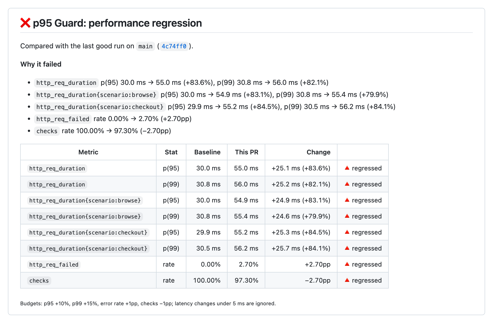
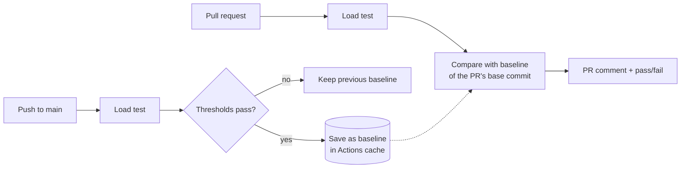

# p95 Guard

[](https://github.com/fatnisponxhaj/p95guard/actions/workflows/ci.yml)
[](https://github.com/marketplace/actions/p95-guard)
[](LICENSE)

**Catch performance regressions before they merge.** p95 Guard compares each pull request's load test results with the last good run on your main branch and posts the change in p95/p99 latency, error rate and checks as a pass/fail PR comment.



- **Works with what you have:** reads the JSON end-of-test summary in both common formats, from `--summary-export` or `handleSummary()`.
- **Per scenario:** compares each scenario separately, so one slow endpoint can't hide behind a fast average.
- **Ignores noise:** changes under 5 ms don't count, whatever the percentage.
- **Handles real-life mess:** empty runs, renamed scenarios, changed thresholds, a missing p99, no baseline yet.
- **One comment per PR:** updated on every push, not repeated.
- **No servers, no accounts, no dependencies:** the baseline lives in the GitHub Actions cache.

## Quick start

```yaml
# .github/workflows/performance.yml
name: Performance

on:
  push:
    branches: [main]
  pull_request:

permissions:
  contents: read
  pull-requests: write # to post the PR comment

jobs:
  load-test:
    runs-on: ubuntu-latest
    steps:
      - uses: actions/checkout@v7
      # ...start the service you want to test...
      # ...run your load test so it writes its JSON summary to summary.json.
      #    Give that step `continue-on-error: true`, so the guard still reports
      #    when the test's own thresholds fail.
      - uses: fatnisponxhaj/p95guard@v0
        with:
          summary: summary.json
```

## How it works



1. On pushes to the default branch, a run that passes its own thresholds becomes the new baseline ("last good run").
2. On pull requests, the run is compared with the baseline of the commit the PR is based on, or the newest baseline if that commit has none.
3. The check fails when p95, p99, error rate or checks got worse than the budget allows, or when one of the test's own thresholds failed.

## Inputs

| Input | Default | Meaning |
|---|---|---|
| `summary` | `summary.json` | Path to the JSON summary of the load test |
| `name` | | Test name when one repo runs several load tests. Each name gets its own baseline and PR comment |
| `metrics` | `http_req_duration` | Trend metrics to compare, comma separated. Per-scenario sub-metrics are included automatically |
| `baseline` | | A baseline file to compare with instead of the cached last good run |
| `mode` | `auto` | `auto`, `compare` or `save-baseline` |
| `p95-budget` | `10` | Max p(95) increase, % |
| `p99-budget` | `15` | Max p(99) increase, % |
| `min-delta-ms` | `5` | Ignore latency changes smaller than this |
| `error-rate-budget` | `1` | Max `http_req_failed` increase, percentage points |
| `checks-budget` | `1` | Max drop of the checks pass rate, percentage points |
| `ignore-thresholds` | `false` | Don't fail on the load test's own failed thresholds |
| `fail-on-regression` | `true` | `false` = report only, never fail the job |
| `comment` | `true` | Post and update the PR comment |
| `cache-key-prefix` | `p95guard-baseline` | Cache key prefix for the baseline |
| `github-token` | `${{ github.token }}` | Token for the PR comment |
| `api-key` | | [p95 Guard Pro](https://p95guard.dev/pricing.html) API key. When set, each run is sent to Pro for trend history |
| `api-url` | `https://p95guard.dev` | Pro API address (for testing) |

## Outputs

| Output | Meaning |
|---|---|
| `verdict` | `pass` or `fail` |
| `regressions` | How many numbers (a stat of a metric) got worse than the budget allows |
| `baseline-found` | `true` when there was a baseline to compare with |
| `report` | Path to the Markdown report |
| `mode` | `compare` or `save-baseline` |
| `uploaded` | `true` when the run was sent to p95 Guard Pro |

## Recipes

### Several load tests in one repo

Give each test a `name`. Each gets its own baseline and its own PR comment.

```yaml
- uses: fatnisponxhaj/p95guard@v0
  with:
    name: api
    summary: api-summary.json
- uses: fatnisponxhaj/p95guard@v0
  with:
    name: checkout
    summary: checkout-summary.json
```

### Roll it out without blocking anyone

Start in report-only mode for a week, look at the numbers, then tune the budgets.

```yaml
- uses: fatnisponxhaj/p95guard@v0
  with:
    fail-on-regression: false
```

### Compare custom metrics

```yaml
- uses: fatnisponxhaj/p95guard@v0
  with:
    metrics: http_req_duration, checkout_latency
```

### Keep the baseline in your repo

Commit a summary you trust and compare against it, without the cache.

```yaml
- uses: fatnisponxhaj/p95guard@v0
  with:
    baseline: perf/baseline.json
```

### Keep the report as an artifact

```yaml
- uses: fatnisponxhaj/p95guard@v0
  id: guard
- uses: actions/upload-artifact@v7
  if: always()
  with:
    name: p95guard-report
    path: ${{ steps.guard.outputs.report }}
```

### Trend history with p95 Guard Pro

[Pro](https://p95guard.dev/pricing.html) keeps every run for 12 months: p95/p99 over time per endpoint, one view for all your repos, Slack alerts when `main` gets slower. Add your key as the repository secret `P95GUARD_API_KEY`:

```yaml
- uses: fatnisponxhaj/p95guard@v0
  with:
    api-key: ${{ secrets.P95GUARD_API_KEY }}
```

Runs on the default branch and on pull requests are both sent. Only the numbers from the load test summary are uploaded (metric names and values) with the repository, branch, commit, PR number and run link. Upload problems show as warnings and never fail your build.

## Tips

- **Add p(99).** It's not in the default summary:
  `summaryTrendStats: ['avg', 'min', 'med', 'max', 'p(90)', 'p(95)', 'p(99)']`
- **Get per-scenario numbers.** Add a threshold per scenario, e.g. `'http_req_duration{scenario:checkout}': ['p(95)<800']`. Tagged sub-metrics only appear in the summary when a threshold uses them.
- **Fight noise.** Shared CI runners vary. Keep budgets around 10–20%, run the test for at least 30 s, and keep the load the same between runs.

## FAQ

**Which summary formats work?** Both JSON formats: the file written with `--summary-export` and the JSON written by `handleSummary()`. CI tests both on every push.

**What about pull requests from forks?** GitHub gives fork PRs a read-only token, so the comment can't be posted. The check still passes or fails, and the full report is in the job summary.

**How long is the baseline kept?** GitHub removes cache entries that haven't been used for 7 days. If nothing runs for a week, the next PR reports "no baseline yet" and the next push to main creates a new one.

**Does it send my data anywhere?** Not unless you set `api-key`. Without it, the action only talks to your repository's GitHub API to post the comment. With it, the run's numbers also go to p95 Guard Pro. See [SECURITY.md](SECURITY.md).

## Use it as a CLI

```bash
node src/cli.js --current summary.json --baseline last-good.json
```

Exit code 0 = pass, 1 = regression, 2 = bad input. Run `node src/cli.js --help` for all flags.

## Contributing

Bug reports and ideas are very welcome: [open an issue](https://github.com/fatnisponxhaj/p95guard/issues/new/choose). See [CONTRIBUTING.md](CONTRIBUTING.md) to run the tests and record your own fixtures.

## License

[MIT](LICENSE)
